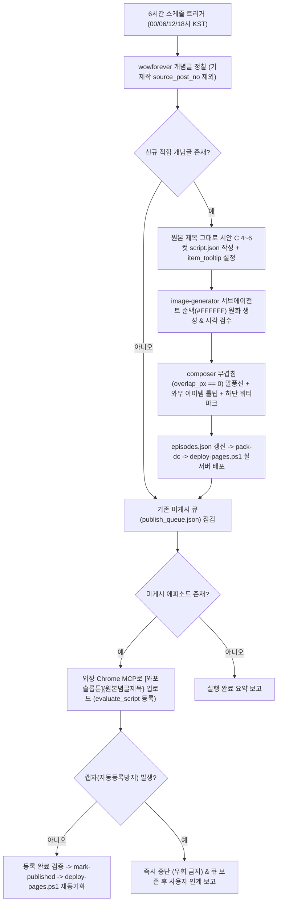

# 와우 포에버 슬롭툰 (`sloptoon`) 6시간 자동 양산 가이드 (`AUTOMATION.md`)

본 문서는 디시인사이드 **WOW 포에버 마이너 갤러리(`wowforever`)** 개념글을 6시간 주기로 정찰·웹툰화(시안 C + 실제 와우 아이템 툴팁)·정적 웹 배포(`https://slopwow.github.io/`)·디시 업로드(`[와포슬롭툰]{원본념글제목}`)까지 자동화하는 **양산 아키텍처와 운영 방법**을 정리합니다.

---

## 1. 자동화 방식 비교 (권장 구성)

| 구분 | **방식 A: Antigravity 예약 자동화 봇 (권장 주력)** | **방식 B: Windows 작업 스케줄러 (`setup-automation.ps1`)** | **방식 C: GitHub Actions (`auto-sloptoon.yml`)** |
| :--- | :--- | :--- | :--- |
| **식별자 / 이름** | **`WOW 포에버 슬롭툰 6시간 자동 양산 봇`** (`wow-sloptoon-factory`) | `WowForeverSloptoonAuto` | `Auto Sloptoon & Deploy Pages` |
| **실행 주기** | `CRON_TZ=Asia/Seoul 0 */6 * * *` (00, 06, 12, 18시 KST) | 등록 시점부터 매 6시간 반복 | `15 */6 * * *` (UTC 기준 6시간 주기) |
| **제목 규칙** | 웹툰 제목 = `원본념글제목` 100% 일치 / 디시 제목 = **`[와포슬롭툰]{원본념글제목}`** | 동일 (`dc_packager` 자동 적용) | 동일 (`writer` / `site_builder` 자동 적용) |
| **원화 & 아이템 툴팁** | `image-generator` 서브에이전트 + 시각 검수 + **실제 와우 아이템 툴팁(`item_tooltip`)** | 로컬 `.env`의 `GEMINI_API_KEY`로 CLI 무인 호출 | GitHub Secrets `GEMINI_API_KEY` 무인 호출 |
| **말풍선·워터마크 합성** | `composer.compose_episode` (`overlap_px == 0`, `tooltip_overlap_px == 0`, 하단 배너) | 동일 (`autopilot` 내장) | 동일 (`run-once` 내장) |
| **디시 포에버갤 업로드** | **외장 Chrome MCP(`chrome-devtools`, 고정닉 `와포슬롭툰`) 자동 업로드** *(캡차 시 즉시 안전 중단)* | 수동 업로드 패키지(`upload_pack/`) 생성 + Windows 알림 (직접 등록) | 정적 웹 아카이브(`gh-pages`) 배포 전용 |

> [!IMPORTANT]
> **중복 실행 방지 안내**: **방식 A (`WOW 포에버 슬롭툰 6시간 자동 양산 봇`)**를 활성화할 때는 작업 충돌을 막기 위해 방식 B(`WowForeverSloptoonAuto`)는 미등록 상태로 두거나(`.\setup-automation.ps1 -Remove`), 오프라인 보조 수단으로만 사용하십시오.

---

## 2. 주력: Antigravity 6시간 자동 양산 봇 (`wow-sloptoon-factory`)

### 설정 파일 위치
- 경로: `C:\Users\kbu39\.gemini\config\sidecars\wow-sloptoon-factory\sidecar.json`
- 표시 이름(`display_name`): **`WOW 포에버 슬롭툰 6시간 자동 양산 봇`**
- 스케줄: `CRON_TZ=Asia/Seoul 0 */6 * * *` (한국 시간 매일 00:00, 06:00, 12:00, 18:00 정각 실행)

### 활성화 방법 (최초 1회)
보안 정책상 에이전트가 `user_config.json`을 직접 수정하여 자동화를 강제 활성화하지 않습니다.
1. Antigravity 내 **Automations 대시보드**(`sidecar://dashboard`)를 엽니다.
2. 목록에서 **`WOW 포에버 슬롭툰 6시간 자동 양산 봇`** (`wow-sloptoon-factory`)을 찾아 토글을 **켜기(Enable)**로 전환합니다.
3. 외장 Chrome이 실행되어 있고 디시인사이드 고정닉 **`와포슬롭툰`** 계정이 로그인된 상태인지 확인합니다.

### 핵심 제작·업로드 규칙 (최신 반영 완료)
1. **원본 념글 제목 100% 일치 & `[와포슬롭툰]{원본념글제목}`**:
   - `script.source_title` 및 `EpisodeRecord.title`은 원본 개념글 제목(`post.title.strip()`)을 요약·변형 없이 **100% 그대로** 사용합니다.
   - 디시인사이드 게시글 제목은 **`[와포슬롭툰]{원본념글제목}`** (예: `[와포슬롭툰]오늘자 RP, 상상도 못한 편지.jpg`)으로 고정합니다 (`EP.{N} — ` 및 `[만화]` 표기 금지).
2. **실제 와우 아이템 툴팁 오버레이 (`ComicCut.item_tooltip` / `ItemTooltipSpec`)**:
   - 개념글에 특정 와우 아이템이 등장할 때(실제 플레이어 닉네임은 철저히 제외, 오직 실제 와우 아이템만 해당!), `ComicCut`의 `item_tooltip` 필드를 통해 해당 컷 빈 모서리에 **실제 다크 네이비(`#0B0D16`) 와우 툴팁 카드**를 무겹침(`tooltip_overlap_px == 0`)으로 합성합니다:
     - **원본 스샷 툴팁 사용**: 원본 글의 아이템 툴팁 스샷을 `assets/items/<slug>.png`에 저장 후 `{"image_path": "assets/items/<slug>.png", "item_name": "...", "quality": "uncommon"}` 지정
     - **한국어 클래식 와우헤드 자동 조회**: `{"wowhead_item_id": 7722, "quality": "rare"}` 지정 시 `https://nether.wowhead.com/tooltip/item/{id}?dataEnv=4&locale=1` 한국어 스탯·착용 효과 및 `wow.zamimg.com` 아이콘을 자동 렌더링 (오프라인·거북이와우 커스텀 아이템 수동 스탯 폴백 지원)
3. **실시간 알림(`#alarm`) 토스트 가림 방지 제출**:
   - 외장 Chrome 업로드 시 디시 실시간 댓글 알림(`#alarm`)이 우측 하단 `등록` 버튼 좌표를 덮어도 클릭이 씹히지 않도록 `evaluate_script`(`(el) => el.click()`)로 안전하게 제출합니다.

### 매 6시간 실행 파이프라인 요약


### 스코프된 최소 권한 (`agent_permissions`)
와일드카드(`command(*)`, `mcp(*)`, `read_url(*)` 등) 없이 검증된 최소 권한만 부여되어 있습니다:
- **워크스페이스**: `file:///C:/Users/kbu39/Desktop/antigravity/sloptoon`
- **파일 접근**: `C:/Users/kbu39/Desktop/antigravity/sloptoon` 읽기·쓰기, `C:/Users/kbu39/.gemini/antigravity/mcp/chrome-devtools` 스키마 읽기
- **도메인 조회**: `gall.dcinside.com`, `nether.wowhead.com`, `ko.classic.wowhead.com`
- **검증된 CLI 명령**: `python -m wow_sloptoon.cli`, `python -m pytest`, `python -c`, `powershell -ExecutionPolicy Bypass -File`, `git`, `gh api`, `Copy-Item`, `Remove-Item`
- **외장 Chrome MCP (`chrome-devtools`)**: `list_pages`, `select_page`, `new_page`, `close_page`, `navigate_page`, `take_snapshot`, `click`, `fill`, `upload_file`, `evaluate_script`, `handle_dialog`, `wait_for`

---

## 3. 운영 도우미 스크립트 (`run-factory.ps1`)

프로젝트 루트(`C:\Users\kbu39\Desktop\antigravity\sloptoon`)에서 한 줄로 자동화 상태, 개념글 후보, 업로드 큐, 실서버 배포를 제어할 수 있습니다.

```powershell
# 1) 전체 상태 읽기 전용 점검 (사이드카 설정 + 작업 스케줄러 + 최신화/업로드 큐 현황)
powershell -ExecutionPolicy Bypass -File .\run-factory.ps1

# 2) 미제작 포에버갤 개념글 후보 정찰 (최근 3페이지)
powershell -ExecutionPolicy Bypass -File .\run-factory.ps1 -Scout -Pages 3

# 3) 디시 업로드 큐(data/publish_queue.json) 동기화 및 표 출력
powershell -ExecutionPolicy Bypass -File .\run-factory.ps1 -SyncQueue

# 4) API 호출 없이 오토파일럿 드라이런 점검
powershell -ExecutionPolicy Bypass -File .\run-factory.ps1 -DryRun

# 5) 로컬 정적 사이트(site/) 빌드만 수행
powershell -ExecutionPolicy Bypass -File .\run-factory.ps1 -BuildSite

# 6) 정적 사이트 빌드 + GitHub main & gh-pages(https://slopwow.github.io/) 원클릭 배포
powershell -ExecutionPolicy Bypass -File .\run-factory.ps1 -Deploy
```

---

## 4. 선택적 보조 수단: Windows 작업 스케줄러 (`setup-automation.ps1`)

Antigravity를 띄우지 않은 순수 백그라운드 환경에서 Python CLI(`python -m wow_sloptoon.cli autopilot --deploy`)만으로 정적 사이트 연재와 업로드 팩 생성까지만 자동 실행하고 싶을 때 사용합니다(디시인사이드 글 등록은 수동 수행).

```powershell
# 상태 확인
powershell -ExecutionPolicy Bypass -File .\setup-automation.ps1 -Status

# 6시간 주기 Windows 작업 스케줄러(WowForeverSloptoonAuto) 등록
powershell -ExecutionPolicy Bypass -File .\setup-automation.ps1

# 등록 해제 (Antigravity 봇 단독 운영 시 권장)
powershell -ExecutionPolicy Bypass -File .\setup-automation.ps1 -Remove
```

---

## 5. 캡차(CAPTCHA) 발생 시 수동 이어받기 절차

자동 양산 봇이 디시인사이드 업로드 도중 **자동등록방지(CAPTCHA)**를 감지하면 규정에 따라 즉시 제출을 멈추며, 웹툰 파일과 업로드 패키지는 이미 실서버(`https://slopwow.github.io/`)와 로컬 `upload_pack/<ep_id>/`에 준비된 상태로 유지됩니다.

1. 관리자 큐 대시보드(`https://slopwow.github.io/publish.html`) 확인 또는 터미널에서 큐 조회:
   ```powershell
   python -m wow_sloptoon.cli queue
   ```
2. 열린 외장 Chrome 창에서 직접 캡차를 입력하고 **등록** 클릭 (또는 수동 도우미 실행):
   ```powershell
   python -m wow_sloptoon.cli publish-next --open-folder --open-browser --copy-body
   ```
3. 등록된 디시 게시글 URL을 기록하고 아카이브 상태 반영:
   ```powershell
   python -m wow_sloptoon.cli mark-published <ep_id> --dc-url "<등록된_디시_URL>"
   powershell -ExecutionPolicy Bypass -File .\deploy-pages.ps1
   ```
