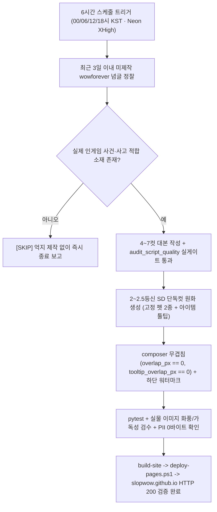

# 와우 포에버 슬롭툰 (`sloptoon`) 6시간 자동 양산 가이드 (`AUTOMATION.md`)

본 문서는 디시인사이드 **WOW 포에버 마이너 갤러리(`wowforever`)** 최신 개념글(2026-11 정식 출시 이후, 최근 3일 이내) 중 실제 인게임 사건·사고만 엄선해 **노선 A (2~2.5등신 귀염뽀짝 SD 단일 정본)** 4~7컷 완결 웹툰으로 자동 제작하고, 정적 웹 아카이브([slopwow.github.io](https://slopwow.github.io/)) 전용으로 배포하는 운영 방법을 정리합니다.

> **운영 정책**: 디시인사이드 자동 게시 및 수동 업로드 도우미는 영구 중단되었으며, 모든 자동화 파이프라인은 순백(`#FFFFFF`) 정적 웹 아카이브([slopwow.github.io](https://slopwow.github.io/)) 배포까지만 수행합니다.

---

## 1. 자동화 방식 비교 (권장 구성)

| 구분 | **방식 A: Antigravity 예약 자동화 봇 (권장 주력)** | **방식 B: Windows 작업 스케줄러 (`setup-automation.ps1`)** | **방식 C: GitHub Actions (`auto-sloptoon.yml`)** |
| :--- | :--- | :--- | :--- |
| **식별자 / 이름** | **`WOW 포에버 슬롭툰 6시간 자동 양산 봇`** (`wow-sloptoon-factory`) | `WowForeverSloptoonAuto` | `Auto Sloptoon & Deploy Pages` |
| **실행 주기 및 모델** | `CRON_TZ=Asia/Seoul 0 */6 * * *` (하루 최대 4편) · **`Gemini 4 Neon (XHigh)`** + 스웜 병렬 | 등록 시점부터 매 6시간 반복 | `15 */6 * * *` (UTC 기준 6시간 주기) |
| **소재 선정 게이트** | **최근 3일(72시간) 이내** 실제 인게임 사건·사고 1편 엄선 (적합 소재 없으면 **자동 스킵** · 인벤/베타/RP/저격/진영비교 영구 제외) | `scout` 상위 후보 1편 | `scout` 상위 후보 1편 |
| **서사·제목·익명성** | 4~7컷(권장 5~6컷) · 말풍선 1~2줄(16~30자) 구어체 · 원본 념글 제목 100% 원문 일치 · 100% 익명화 | 동일 (`writer` / `audit_script_quality` 자동 적용) | 동일 (`writer` / `audit_script_quality` 자동 적용) |
| **원화 & 아이템 툴팁** | 노선 A 2~2.5등신 SD 단일 정본 + 고정 펫 2종 + **실제 와우 아이템 툴팁(`item_tooltip`)** | 로컬 `.env`의 `GEMINI_API_KEY`로 CLI 무인 호출 | GitHub Secrets `GEMINI_API_KEY` 무인 호출 |
| **배포 대상** | **`https://slopwow.github.io/` 정적 웹 아카이브 실서버 배포 전용** | **`https://slopwow.github.io/` 정적 웹 아카이브 배포 전용** | **GitHub Pages 정적 웹 아카이브 배포 전용** |

> [!IMPORTANT]
> **중복 실행 방지 안내**: **방식 A (`WOW 포에버 슬롭툰 6시간 자동 양산 봇`)**를 활성화할 때는 작업 충돌을 막기 위해 방식 B(`WowForeverSloptoonAuto`)는 미등록 상태로 두거나(`.\setup-automation.ps1 -Remove`), 오프라인 보조 수단으로만 사용하십시오.

---

## 2. 주력: Antigravity 6시간 자동 양산 봇 (`wow-sloptoon-factory`)

### 설정 파일 위치
- 경로: `~/.gemini/config/sidecars/wow-sloptoon-factory/sidecar.json`
- 표시 이름(`display_name`): **`WOW 포에버 슬롭툰 6시간 자동 양산 봇`**
- 실행 모델: `--model=gemini-4-neon-xhigh` (**Gemini 4 Neon (XHigh)** 고정)
- 스케줄: `CRON_TZ=Asia/Seoul 0 */6 * * *` (한국 시간 매일 00:00, 06:00, 12:00, 18:00 — 하루 최대 4편)

### 활성화 방법 (최초 1회)
보안 정책상 에이전트가 `user_config.json`을 직접 수정하여 자동화를 강제 활성화하지 않습니다.
1. Antigravity 내 **Automations 대시보드**(`sidecar://dashboard`)를 엽니다.
2. 목록에서 **`WOW 포에버 슬롭툰 6시간 자동 양산 봇`** (`wow-sloptoon-factory`)을 찾아 토글을 **켜기(Enable)**로 전환합니다.

### 핵심 제작·검수 규칙 (노선 A 단일 정본)
1. **최근 3일 이내 포에버갤 사건·사고 엄선 및 억지 제작 금지**:
   - 2026-11 정식 출시 이후, 최근 3일(72시간) 이내 등록된 포에버갤(`wowforever`) 미제작 념글 중 닌자·먹튀·입찰 분쟁·억까·파티 참사 등 공감과 재미가 확실한 사건·사고 1편만 선정합니다.
   - 와우 인벤, 베타 글(2026-10 이전), `🎬RP` 연재, 닉네임·길드 저격글, 진영 비교글, 정치·현실 분쟁은 영구 제외하며, 적합 소재가 없으면 억지로 만들지 않고 `[SKIP]` 보고 후 종료합니다.
2. **념글 미독자 100% 이해 4~7컷 완결 & 1~2줄 찰진 구어체**:
   - 원글을 안 읽어도 완결 이해되는 **4~7컷(권장 5~6컷)** 구성과 **무언 대왕 클로즈업 정지 컷(`wordless=True`) 최소 1컷**을 보장합니다.
   - **말풍선당 1~2줄(16~30자) 와우 구어체**로 작성하며 3줄 벽돌(40자+), AI 존댓말 해설체, 애교 유행어 복붙, 욕설, 현실 현대어를 금지합니다(`audit_script_quality` 실게이트 통과 필수).
   - `script.source_title` 및 `EpisodeRecord.title`은 원본 념글 제목 100% 원문 일치, 당사자 아이디·닉네임·길드명은 0글자 익명화(직업 호칭만 표기)를 강제합니다.
3. **2~2.5등신 귀염뽀짝 SD 단일 정본 & 실제 아이템 툴팁**:
   - 스타일 마스터 `assets/diorama_style_ref.jpg` + 9인 2.5등신 턴어라운드 `assets/turnarounds/<cast_id>.jpg` + 고정 동행 펫 2종(`hunter_bear.jpg` 아기 곰, `warlock_voidwalker.jpg` 공허방랑자)만 사용합니다(3.5~4등신 마네킹·흑마 임프 중복 소지 영구 폐기, 모든 몹·NPC·엑스트라 동일 SD 통일).
   - 핵심 아이템 컷에는 공식 `WOWF.IO`/와우헤드 한국어 아이템 툴팁(`ComicCut.item_tooltip`)을 `tooltip_overlap_px == 0`으로 합성합니다.
4. **클린 정적 웹 아카이브 전용 배포 & 4대 안전선**:
   - 방문자 클린 사이트([slopwow.github.io](https://slopwow.github.io/), 업로드·관리·디버그 UI 0개, PUBLIC PII·로컬 절대경로·비밀정보 0바이트) 빌드·배포까지만 수행합니다.

### 매 6시간 실행 파이프라인 요약


### 스코프된 최소 권한 (`agent_permissions`)
와일드카드(`command(*)`, `mcp(*)`, `read_url(*)` 등) 없이 검증된 최소 권한만 부여합니다:
- **워크스페이스**: `file:///<REPO_ROOT>`
- **파일 접근**: `<REPO_ROOT>` 읽기·쓰기, 스웜 내장 스킬(`native_swarm`, `swarm_pane`, `swarm_monitor`) 읽기
- **도메인 조회**: `gall.dcinside.com`, `nether.wowhead.com`, `ko.classic.wowhead.com`, `wow.zamimg.com`
- **검증된 CLI 명령**: `python -m wow_sloptoon.cli`, `python -m pytest`, `python -c`, `powershell -ExecutionPolicy Bypass -File`, `git`, `gh api`

---

## 3. 운영 도우미 스크립트 (`run-factory.ps1`)

프로젝트 루트(`<REPO_ROOT>`)에서 한 줄로 자동화 상태, 개념글 후보 정찰, 드라이런, 정적 아카이브 빌드·배포를 제어할 수 있습니다.

```powershell
# 1) 전체 상태 읽기 전용 점검 (사이드카 설정 + 작업 스케줄러 + 정적 아카이브 현황)
powershell -ExecutionPolicy Bypass -File .\run-factory.ps1

# 2) 미제작 포에버갤 개념글 후보 정찰 (최근 3페이지)
powershell -ExecutionPolicy Bypass -File .\run-factory.ps1 -Scout -Pages 3

# 3) API 호출 없이 오토파일럿 드라이런 점검
powershell -ExecutionPolicy Bypass -File .\run-factory.ps1 -DryRun

# 4) 로컬 정적 사이트(site/) 빌드만 수행
powershell -ExecutionPolicy Bypass -File .\run-factory.ps1 -BuildSite

# 5) 전체 통합본 하단 유인 배너(watermark) 일괄 점검·적용
powershell -ExecutionPolicy Bypass -File .\run-factory.ps1 -Watermark

# 6) 정적 사이트 빌드 + GitHub main & gh-pages(https://slopwow.github.io/) 원클릭 배포
powershell -ExecutionPolicy Bypass -File .\run-factory.ps1 -Deploy
```

---

## 4. 선택적 보조 수단: Windows 작업 스케줄러 (`setup-automation.ps1`)

Antigravity를 띄우지 않은 순수 백그라운드 환경에서 Python CLI(`python -m wow_sloptoon.cli autopilot --deploy`)만으로 정적 웹 아카이브 연재와 배포를 자동 실행하고 싶을 때 사용합니다.

```powershell
# 상태 확인
powershell -ExecutionPolicy Bypass -File .\setup-automation.ps1 -Status

# 6시간 주기 Windows 작업 스케줄러(WowForeverSloptoonAuto) 등록
powershell -ExecutionPolicy Bypass -File .\setup-automation.ps1

# 등록 해제 (Antigravity 봇 단독 운영 시 권장)
powershell -ExecutionPolicy Bypass -File .\setup-automation.ps1 -Remove
```

---

## 5. 실물 E2E 검증 및 배포 체크리스트

자동화 또는 수동 배포 전·후에 아래 5가지 항목을 반드시 확인합니다:

1. **단위·통합·무결성 테스트 통과**:
   ```powershell
   python -m pytest -v
   ```
2. **실물 렌더링 검수**: 생성된 `episode_full.jpg` 및 `page_*.png`를 직접 확인해 2~2.5등신 SD 화풍 통일, 1~2줄 말풍선 가독성, 말풍선·툴팁 무겹침(`overlap_px == 0`, `tooltip_overlap_px == 0`), 하단 `slopwow.github.io` 워터마크 유지를 확인합니다.
3. **메타 정합성 확인**: `data/episodes/<ep_id>/record.json`과 `data/episodes.json`의 `cut_count`, `page_images_rel`, `cast_used`, `title == source_title` 일치를 확인합니다.
4. **4대 안전선(PUBLIC 0 PII/비밀정보) 확인**: `site/` 내 업로드·관리·디버그 UI 0건, 공개 파일 내 개인 실명·소속·거주지·로컬 절대경로·API 키·`.env*` 커밋 0바이트를 확인합니다.
5. **라이브 실서버 검증**: `https://slopwow.github.io/` 및 신규 에피소드 페이지의 HTTP 200 응답과 콘솔 0에러를 확인합니다.
