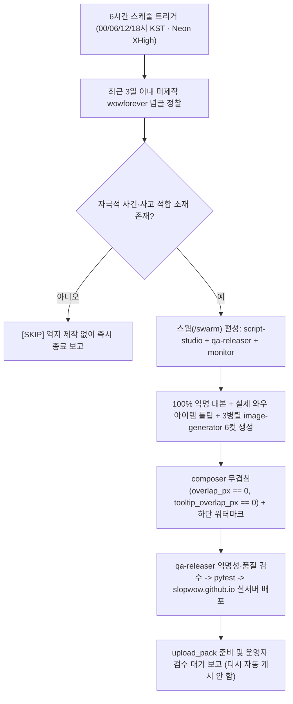

# 와우 포에버 슬롭툰 (`sloptoon`) 6시간 자동 양산 가이드 (`AUTOMATION.md`)

본 문서는 디시인사이드 **WOW 포에버 마이너 갤러리(`wowforever`)** 최신 개념글(최근 3일 이내) 중 자극적인 인게임 사건·사고만 엄선해 **Gemini 4 Neon (XHigh) + 스웜(`/swarm`) 병렬 파이프라인**으로 6시간 주기 자동 양산(하루 최대 4편, 적합한 소재가 없으면 스킵)하고 `https://slopwow.github.io/` 배포까지 마친 뒤 운영자 검수 후 포에버갤에 게시하는 운영 방법을 정리합니다.

---

## 1. 자동화 방식 비교 (권장 구성)

| 구분 | **방식 A: Antigravity 예약 자동화 봇 (권장 주력)** | **방식 B: Windows 작업 스케줄러 (`setup-automation.ps1`)** | **방식 C: GitHub Actions (`auto-sloptoon.yml`)** |
| :--- | :--- | :--- | :--- |
| **식별자 / 이름** | **`WOW 포에버 슬롭툰 6시간 자동 양산 봇`** (`wow-sloptoon-factory`) | `WowForeverSloptoonAuto` | `Auto Sloptoon & Deploy Pages` |
| **실행 주기 및 모델** | `CRON_TZ=Asia/Seoul 0 */6 * * *` (하루 최대 4편) · **`Gemini 4 Neon (XHigh)`** + 스웜 병렬 | 등록 시점부터 매 6시간 반복 | `15 */6 * * *` (UTC 기준 6시간 주기) |
| **소재 선정 게이트** | **최근 3일(72시간) 이내** 실제 인게임 사건·사고 1편 엄선 (적합 소재 없으면 **자동 스킵** · RP/진영비교 영구 제외) | `scout` 상위 후보 1편 | `scout` 상위 후보 1편 |
| **제목 및 익명성** | 원본 념글 제목 100% 일치 (`[와포슬롭툰]{원본념글제목}`) · **사고 당사자 아이디·길드명 0글자 익명** | 동일 (`dc_packager` 자동 적용) | 동일 (`writer` / `site_builder` 자동 적용) |
| **원화 & 아이템 툴팁** | 스웜 + 3병렬 `image-generator` 팬아웃 + **실제 와우 아이템 툴팁(`item_tooltip`)** | 로컬 `.env`의 `GEMINI_API_KEY`로 CLI 무인 호출 | GitHub Secrets `GEMINI_API_KEY` 무인 호출 |
| **배포 및 디시 게시** | **`slopwow.github.io` 실서버 배포 + `upload_pack/` 준비까지만 자동** *(운영자 검수 승인 후 외장 Chrome 게시)* | 수동 업로드 패키지(`upload_pack/`) 생성 + Windows 알림 | 정적 웹 아카이브(`gh-pages`) 배포 전용 |

> [!IMPORTANT]
> **중복 실행 방지 안내**: **방식 A (`WOW 포에버 슬롭툰 6시간 자동 양산 봇`)**를 활성화할 때는 작업 충돌을 막기 위해 방식 B(`WowForeverSloptoonAuto`)는 미등록 상태로 두거나(`.\setup-automation.ps1 -Remove`), 오프라인 보조 수단으로만 사용하십시오.

---

## 2. 주력: Antigravity 6시간 자동 양산 봇 (`wow-sloptoon-factory`)

### 설정 파일 위치
- 경로: `~/.gemini/config/sidecars/wow-sloptoon-factory/sidecar.json`
- 표시 이름(`display_name`): **`WOW 포에버 슬롭툰 6시간 자동 양산 봇`**
- 실행 모델: `--model=gemini-4-neon-xhigh` (**Gemini 4 Neon (XHigh)** 고정)
- 스케줄: `CRON_TZ=Asia/Seoul 0 */6 * * *` (한국 시간 매일 00:00, 06:00, 12:00, 18:00 — 하루 최대 4편)

### 활성화 방법 (최초 1회)
보안 정책상 에이전트가 `user_config.json`을 직접 수정하여 자동화를 강제 활성화하지 않습니다.
1. Antigravity 내 **Automations 대시보드**(`sidecar://dashboard`)를 엽니다.
2. 목록에서 **`WOW 포에버 슬롭툰 6시간 자동 양산 봇`** (`wow-sloptoon-factory`)을 찾아 토글을 **켜기(Enable)**로 전환합니다.

### 핵심 제작·검수 규칙 (최신 반영 완료)
1. **최근 3일 이내 사건·사고 엄선 및 억지 제작 금지**:
   - 최근 3일(72시간) 이내 등록된 포에버갤 미제작 념글 중 닌자·먹튀·입찰 분쟁·이중특성 궤변·파티 참사 등 공감과 재미가 확실한 사건·사고 1편만 선정합니다.
   - `🎬RP` 말머리·장문 RP 연재, 지루한 진영 비교/일반론, 정치·현실 분쟁, 패치노트는 영구 제외하며, 최근 3일 내 적절한 소재가 없으면 억지로 만들지 않고 `[SKIP]` 보고 후 종료합니다.
2. **원본 념글 제목 100% 일치 & 100% 익명성 (고소 방지)**:
   - `script.source_title` 및 `EpisodeRecord.title`은 원본 념글 제목(`post.title.strip()`) 그대로 사용하며 디시 등록 제목은 **`[와포슬롭툰]{원본념글제목}`**으로 고정합니다.
   - 사고 당사자의 실제 아이디·닉네임·길드명(패러디 포함)은 대사·부제·크롭 이미지 어디에도 절대 적지 않고 오직 직업 호칭만 사용합니다.
3. **실제 와우 아이템 툴팁 오버레이 (`ComicCut.item_tooltip`)**:
   - 원글 첨부 공식 `WOWF.IO`/인게임 툴팁 스샷(`assets/items/<slug>.png`) 또는 한국어 클래식 와우헤드(`https://nether.wowhead.com/tooltip/item/{id}?dataEnv=4&locale=1` + `wow.zamimg.com` 아이콘)를 `tooltip_overlap_px == 0`으로 합성합니다.
4. **선(先) 사이트 배포 · 후(後) 검수 승인 업로드**:
   - 방문자 클린 사이트(`https://slopwow.github.io/`, `publish.html`/글쓰기 링크 0개) 배포 및 로컬 `upload_pack/` 준비까지만 자동 수행하고, 운영자가 검수 후 승인할 때만 외장 Chrome으로 포에버갤에 게시합니다.

### 매 6시간 실행 파이프라인 요약


### 스코프된 최소 권한 (`agent_permissions`)
와일드카드(`command(*)`, `mcp(*)`, `read_url(*)` 등) 없이 검증된 15개 최소 권한만 부여되어 있습니다:
- **워크스페이스**: `file:///<REPO_ROOT>`
- **파일 접근**: `<REPO_ROOT>` 읽기·쓰기, 스웜 내장 스킬(`native_swarm`, `swarm_pane`, `swarm_monitor`) 읽기
- **도메인 조회**: `gall.dcinside.com`, `nether.wowhead.com`, `ko.classic.wowhead.com`, `wow.zamimg.com`
- **검증된 CLI 명령**: `python -m wow_sloptoon.cli`, `python -m pytest`, `python -c`, `powershell -ExecutionPolicy Bypass -File`, `git`, `gh api`

---

## 3. 운영 도우미 스크립트 (`run-factory.ps1`)

프로젝트 루트(`<REPO_ROOT>`)에서 한 줄로 자동화 상태, 개념글 후보, 업로드 큐, 실서버 배포를 제어할 수 있습니다.

```powershell
# 1) 전체 상태 읽기 전용 점검 (사이드카 설정 + 작업 스케줄러 + 최신화/업로드 큐 현황)
powershell -ExecutionPolicy Bypass -File .\run-factory.ps1

# 2) 미제작 포에버갤 개념글 후보 정찰 (최근 3페이지)
powershell -ExecutionPolicy Bypass -File .\run-factory.ps1 -Scout -Pages 3

# 3) 디시 업로드 큐(data/publish_queue.json) 동기화 및 표 출력
powershell -ExecutionPolicy Bypass -File .\run-factory.ps1 -SyncQueue

# 4) API 호출 없이 오토파일럿 드라이런 점검
powershell -ExecutionPolicy Bypass -File .\run-factory.ps1 -DryRun

# 5) 로컬 정적 사이트(site/) 빌드만 수행
powershell -ExecutionPolicy Bypass -File .\run-factory.ps1 -BuildSite

# 6) 정적 사이트 빌드 + GitHub main & gh-pages(https://slopwow.github.io/) 원클릭 배포
powershell -ExecutionPolicy Bypass -File .\run-factory.ps1 -Deploy
```

---

## 4. 선택적 보조 수단: Windows 작업 스케줄러 (`setup-automation.ps1`)

Antigravity를 띄우지 않은 순수 백그라운드 환경에서 Python CLI(`python -m wow_sloptoon.cli autopilot --deploy`)만으로 정적 사이트 연재와 업로드 팩 생성까지만 자동 실행하고 싶을 때 사용합니다(디시인사이드 글 등록은 수동 수행).

```powershell
# 상태 확인
powershell -ExecutionPolicy Bypass -File .\setup-automation.ps1 -Status

# 6시간 주기 Windows 작업 스케줄러(WowForeverSloptoonAuto) 등록
powershell -ExecutionPolicy Bypass -File .\setup-automation.ps1

# 등록 해제 (Antigravity 봇 단독 운영 시 권장)
powershell -ExecutionPolicy Bypass -File .\setup-automation.ps1 -Remove
```

---

## 5. 캡차(CAPTCHA) 발생 시 수동 이어받기 절차

자동 양산 봇이 디시인사이드 업로드 도중 **자동등록방지(CAPTCHA)**를 감지하면 규정에 따라 즉시 제출을 멈추며, 웹툰 파일과 업로드 패키지는 이미 실서버(`https://slopwow.github.io/`)와 로컬 `upload_pack/<ep_id>/`에 준비된 상태로 유지됩니다.

1. 관리자 큐 대시보드(`https://slopwow.github.io/publish.html`) 확인 또는 터미널에서 큐 조회:
   ```powershell
   python -m wow_sloptoon.cli queue
   ```
2. 열린 외장 Chrome 창에서 직접 캡차를 입력하고 **등록** 클릭 (또는 수동 도우미 실행):
   ```powershell
   python -m wow_sloptoon.cli publish-next --open-folder --open-browser --copy-body
   ```
3. 등록된 디시 게시글 URL을 기록하고 아카이브 상태 반영:
   ```powershell
   python -m wow_sloptoon.cli mark-published <ep_id> --dc-url "<등록된_디시_URL>"
   powershell -ExecutionPolicy Bypass -File .\deploy-pages.ps1
   ```
